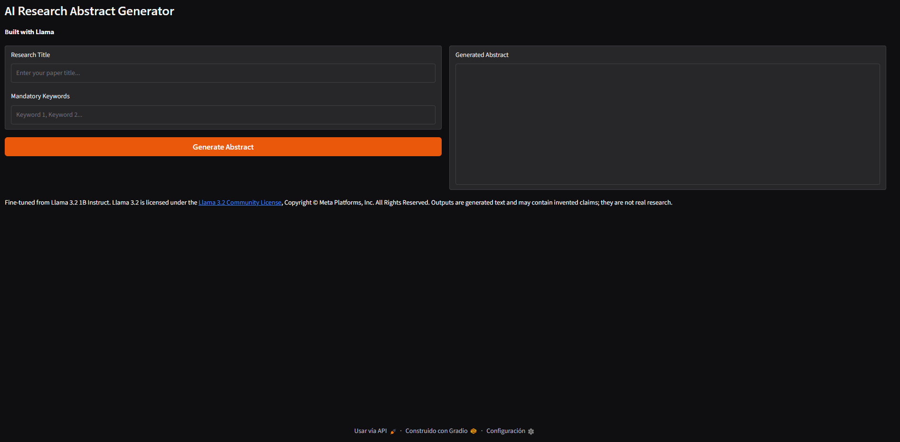
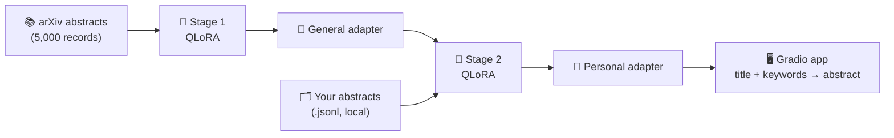

# ✍️ AI Abstract Generator

### Draft variations of your own academic abstracts with a small fine-tuned LLM — runs on your own GPU, nothing leaves your machine

**Built with Llama**


| 🔒 Private | 🎯 Personalised | 🔑 Keyword-aware | 🐳 Portable |
|---|---|---|---|
| Training and inference stay on your machine | Two-stage fine-tuning imitates your own writing | Mandatory keywords are part of the prompt | GPU-ready multi-stage Docker image |




## 💡 Overview

A side project built in my spare time to answer my **real need**: researchers often have to write several versions of the same abstract (the same study presented at different events), each with its own required keywords. I wanted to make the code work for me and use all my previous abstracts to learn about my style and preferences.

A 1B-parameter, 4-bit Llama 3.2 Instruct model was fine-tuned in two stages with [Unsloth](https://github.com/unslothai/unsloth) on a local GPU:

1. **Stage 1, academic style:** QLoRA on arXiv titles and abstracts, so the model learns how abstracts are written.
2. **Stage 2, your voice:** the stage 1 result is trained again on a small local `.jsonl` file of your own earlier titles, abstracts and **keywords**. Adding keywords to the training prompt is what lets the final model take mandatory keywords as an input.

A Gradio app then turns a **title + keywords** into a draft abstract. English only.

> [!NOTE]
> This repository contains **code only**: no model weights, no adapters and no personal data. To use it you must **provide your own dataset of abstracts in `.jsonl` format** and train your own adapter (see [Training](#-training)). The base model is subject to the Llama 3.2 Community License.

> [!IMPORTANT]
> The output is generated text. It can contain invented claims, methods and results, and it is **not** real research. See **Responsible Use** below.

## ✨ Features

- 🔒 **Local by design:** both fine-tuning and generation run on your own GPU.
- 🎯 **Personalised output:** a second fine-tuning stage imitates your previous abstracts.
- 🔑 **Keyword input:** keywords are included in the training prompt and in the generation prompt.
- 🖥️ **Web app (Gradio):** title and keywords in, abstract out.
- ⚡ **Efficient training:** 4-bit base model, LoRA adapters, gradient checkpointing and an 8-bit optimizer, sized for a laptop GPU.
- 🐳 **Docker support:** multi-stage build on NVIDIA CUDA images, non-root user, persistent model cache.

## 🛠️ Technical Highlights

| | Area | What this project shows |
|:---|---|---|
| 🧠 | **LLM fine-tuning** | QLoRA with Unsloth and TRL's `SFTTrainer`; LoRA on all attention and MLP projections (rank 16) |
| 🔁 | **Two-stage adaptation** | General academic style first, personal style and keyword conditioning second |
| 🧪 | **Training judgement** | Stage 2 limited to 15 steps after 60 steps led to overfitting on a tiny dataset |
| 🔑 | **Prompt/data design** | Same chat template and system prompt in training and inference, with keywords as an explicit constraint |
| 📦 | **Packaging** | Multi-stage CUDA Docker image (installation in a *devel* image, a slimmer *runtime* image to run it), non-root user, only the app copied in |
| ⚖️ | **Compliance** | Llama 3.2 licence and attribution handled, dataset licence and library licences documented in `ThirdPartyNotices.md` |

**Stack:** Python · Unsloth · PyTorch · TRL · PEFT · Transformers · Gradio · Docker

## 📋 Requirements

| Element | Version | Description |
|---|---|---|
| 🐍 **Python** | 3.12 | Version used for the Docker image and for testing |
| 🎮 **NVIDIA GPU + drivers** | 6 GB+ VRAM | A CUDA GPU is required; the app places the model on `cuda` |
| 🦥 **unsloth** | 2026.3.4 | Fine-tuning and fast inference (pinned in `requirements.txt`) |
| 🔥 **torch** | 2.6.0 (CUDA 12.4 build) | Deep-learning backend, installed from the PyTorch CUDA 12.4 index in `requirements.txt` |
| 🎛️ **gradio** | any | Web interface |
| 🧩 **trl, peft, transformers, accelerate, datasets, bitsandbytes** | 0.24.0, 0.18.1, 5.2.0, 1.13.0, 4.3.0, 0.49.2 | Training stack installed with Unsloth; the versions used in testing |
| 🧮 **RAM** | 16 GB (32 GB recommended) | Training and inference |
| 💾 **Disk space** | 15 GB free | CUDA image, PyTorch and model checkpoints |
| 🌐 **Network** | First run only | Downloads the base model (and, for training, the dataset) from the Hugging Face Hub |
| 🗂️ **Your own dataset** | `abstracts.jsonl` | **Required.** Your previous titles, abstracts and keywords in JSON Lines format (see [Training](#-training)); not included in this repository |
| 🐳 **Docker + GPU access** | Optional | Docker Desktop with WSL 2, or Docker Engine with the NVIDIA Container Toolkit, for the container option |

Python packages are listed in `requirements.txt`.

## 🚀 Get Started

The repository ships no model and no data. **Before the app can generate anything, insert your own dataset** (`abstracts.jsonl`, in JSON Lines format, described in [Training](#-training)) and train your adapter with it.

### 💻 Run locally

```bash
# 1. Clone the repository
git clone https://github.com/polendol/AbstractGenerator.git
cd AbstractGenerator

# 2. Create and activate a virtual environment
python -m venv .venv
source .venv/bin/activate          # Windows: .venv\Scripts\activate

# 3. Install the dependencies
pip install -r requirements.txt

# 4. Insert your own dataset: create abstracts.jsonl in the project folder
#    (format: see "Training" below)

# 5. Train the two stages (the adapter is saved inside the project folder)
python Training.py
python TrainingMyDataset.py

# 6. Start the web app
python AbstractGenerator.py
```

Run every command from the project folder. The training scripts save the adapter in `unsloth/Llama-3.2-1B-Instruct-bnb-4bit-lora_private_abstracts`, and the app loads that folder by default. To load an adapter from another location, set the `MODEL_PATH` environment variable.

The app runs on `localhost`, port `7860` by default, and is only reachable from your own computer.

> [!TIP]
> The first start is slower: the base model is downloaded once and cached on disk. Later starts reuse it.

### 🐳 Run with Docker

Train your adapter locally first (steps 4 and 5 above), then build and run the image from the project folder.

**Linux / macOS / WSL**

```bash
docker build -t abstract-generator .

docker run --gpus all -p 7860:7860 \
  -v hf_cache:/home/appuser/.cache/huggingface \
  -v "$(pwd)/unsloth/Llama-3.2-1B-Instruct-bnb-4bit-lora_private_abstracts:/app/adapter:ro" \
  abstract-generator
```

**Windows (PowerShell)**: the same command on a single line, with `${PWD}`:

```powershell
docker build -t abstract-generator .

docker run --gpus all -p 7860:7860 -v hf_cache:/home/appuser/.cache/huggingface -v "${PWD}/unsloth/Llama-3.2-1B-Instruct-bnb-4bit-lora_private_abstracts:/app/adapter:ro" abstract-generator
```

The app is then available on `localhost`, port `7860`. The container log prints `http://0.0.0.0:7860`; that is the address inside the container and it does not work in a browser, so type `localhost` with port `7860` instead.

- `--gpus all` gives the container access to your NVIDIA GPU.
- The first `-v` keeps the downloaded base model in a named volume, so it is fetched only once.
- The second `-v` mounts your stage 2 adapter folder read-only at `/app/adapter`, where the container looks for it (`MODEL_PATH`). It is only mapped into the running container: it is not copied into the image or uploaded anywhere, and the image itself contains no model or personal data.
- The multi-stage build installs the dependencies in a CUDA *devel* image and copies only the Python environment into a slimmer CUDA *runtime* image. The runtime image adds a C compiler and the Python headers, because Unsloth's GPU kernels (Triton) compile a small helper the first time they run.

> [!WARNING]
> With `-p 7860:7860`, Docker publishes the port on all network interfaces of the host, so other devices on the same network can also reach the app, and it has no authentication. Use it on trusted networks only. To restrict it to your own computer, use `-p 127.0.0.1:7860:7860`.

<details>
<summary>Troubleshooting: "Unsloth: No config file found"</summary>

The container cannot see your adapter at `/app/adapter` (the image does not contain it). Make sure you used the second `-v` mount and ran the command from the project folder. Then list what the container sees:

```powershell
docker run --rm -v "${PWD}/unsloth/Llama-3.2-1B-Instruct-bnb-4bit-lora_private_abstracts:/app/adapter:ro" --entrypoint ls abstract-generator -la /app/adapter
```

On Linux, macOS or WSL, use `$(pwd)` instead of `${PWD}`. The listing should include `adapter_config.json` and the adapter weights (usually `adapter_model.safetensors`). If it is empty, the path on your computer is wrong or the training stage has not been run. If the folder did not exist, Docker creates an empty one with that name; delete it and fix the path.

</details>

## 🎮 Usage

1. Open the app and type your **Research Title**.
2. Add the **Mandatory Keywords**, separated by commas.
3. Click **Generate Abstract** and read the draft.
4. **Review and edit it.** Check that every keyword and every claim is accurate.

| Setting | Value | Why |
|---|---|---|
| `max_new_tokens` | 512 | Roughly the length of a standard academic abstract |
| `temperature` | 0.6 | Some variety, while academic text stays highly formulaic |
| `repetition_penalty` | 1.2 | Reduces repeated phrases and odd synonyms |
| `max_seq_length` | 1024 | Context size used in training and inference |

The adapter is loaded from `MODEL_PATH`, which defaults to the stage 2 output folder (see [Training](#-training)).

## 🧪 Training

Both stages use Unsloth and TRL's `SFTTrainer` with 4-bit QLoRA, and save the **LoRA adapter only** (no merged weights).

```bash
python Training.py             # stage 1: general academic abstracts
python TrainingMyDataset.py    # stage 2: your own abstracts (abstracts.jsonl)
```

Run both scripts from the project folder. Each one saves its adapter in a local folder: `unsloth/Llama-3.2-1B-Instruct-bnb-4bit-lora_abstracts` for stage 1 and `unsloth/Llama-3.2-1B-Instruct-bnb-4bit-lora_private_abstracts` for stage 2. Stage 2 starts from the stage 1 folder, and the app loads the stage 2 folder by default.

### Data

| | Stage 1 | Stage 2 |
|---|---|---|
| **Script** | `Training.py` | `TrainingMyDataset.py` |
| **Starts from** | `unsloth/Llama-3.2-1B-Instruct-bnb-4bit` | The stage 1 adapter |
| **Data** | [gfissore/arxiv-abstracts-2021](https://huggingface.co/datasets/gfissore/arxiv-abstracts-2021), first 5,000 records of `train`, streamed and not shuffled (CC0 1.0) | Your own `abstracts.jsonl` (private, never committed) |
| **Prompt** | System: `You are a professional academic researcher.` User: expand the title into an abstract | Same, plus `Mandatory Keywords to include: …` and a system prompt that asks to incorporate all keywords |
| **Target** | The original abstract | Your original abstract |

**Insert your own dataset for stage 2.** You must create `abstracts.jsonl` yourself: it is not included and should stay private. Use one JSON object per line (placeholder values shown):

```json
{"instruction": "Expand the following research title into a sophisticated academic abstract.", "input": "Title: <paper title>", "keywords": "keyword one, keyword two", "output": "<the abstract you submitted>"}
```

The user message is built as `instruction`, `input` and the keywords, so keep `input` in the same `Title: …` form the app uses at inference time.

### Configuration

| Setting | Stage 1 | Stage 2 |
|---|---|---|
| Max sequence length | 1024 | 1024 |
| LoRA rank / alpha / dropout | 16 / 16 / 0 | 16 / 16 / 0 |
| LoRA target modules | q, k, v, o, gate, up, down projections | Same |
| Batch size | 1 per device × 8 accumulation steps = 8 | 2 per device × 4 accumulation steps = 8 |
| Training steps | 300 (about 2,400 examples seen) | 15 (60 led to overfitting) |
| Learning rate | 2e-4, linear schedule, 10 warmup steps | Same |
| Optimizer | `paged_adamw_8bit`, weight decay 0.01 | Same |
| Precision | bf16, gradient checkpointing | Same |
| Hardware | `<your GPU model and VRAM>` | Same |

### Results

| | Stage 1 | Stage 2 |
|---|---|---|
| Average training loss | **2.254** | **2.47** |
| Training time | about 14.6 min (878 s), 2.7 samples/s | about 31 s, about 7.7 passes over the small dataset |

> [!NOTE]
> No validation split or held-out evaluation was run, so there are no validation metrics. Output quality was judged qualitatively, by reading generated abstracts.

## ⚙️ How It Works



At startup the app loads the adapter in 4-bit and switches Unsloth to its optimised inference mode. For each request it builds a chat (system role plus user role) that asks for an academic abstract for the given title that includes all mandatory keywords, generates up to 512 new tokens, and returns the assistant's reply.

## 🧠 Model and Limitations

**Base model:** Llama 3.2 1B Instruct (Meta), loaded as the 4-bit build [`unsloth/Llama-3.2-1B-Instruct-bnb-4bit`](https://huggingface.co/unsloth/Llama-3.2-1B-Instruct-bnb-4bit). **No weights are stored in this repository or in the Docker image.**

> [!WARNING]
> **Plausible is not true.** A small model writes fluent academic text without knowing your study. Treat every output as a draft that must be checked against your real work.

- 🔑 **Keywords are requested, not guaranteed.** They are part of the prompt and the training data, but nothing verifies that the output contains them all.
- 📚 **Small, short training runs.** Stage 1 saw about 2,400 of the first 5,000 records, which are not shuffled. Stage 2 uses a very small personal dataset for 15 steps, so it can drift toward memorising your earlier abstracts.
- 🎯 **Loss over the whole conversation.** Training loss is computed on the full formatted chat, not only on the abstract.
- 📏 **No quantitative evaluation.** There are no held-out metrics.
- 🇬🇧 **English only.**
- 🎮 **GPU required.** The app moves its inputs to `cuda`.
- 🔤 **Length cap.** Output is limited to 512 new tokens, so long abstracts can be cut off.
- 🧩 **Simple answer extraction.** The reply is taken from the text after the last occurrence of the word "assistant", so an abstract that contains that word is truncated.

## 🔒 Privacy

- 🏠 Training and generation run on your machine; titles, keywords and abstracts are never sent to an external service.
- 🔐 **Your adapter is as sensitive as your training data.** A fine-tuned adapter can reproduce parts of what it was trained on. Never publish it or commit it to version control.
- 📡 The only outbound connections are model and dataset downloads from the Hugging Face Hub. Afterwards the app can run offline (for example with `HF_HUB_OFFLINE=1`).
- 🦥 In its current source, Unsloth makes an anonymous usage-statistics request to the Hugging Face Hub (platform type, rounded VRAM and GPU count, no text). Set `UNSLOTH_DISABLE_STATISTICS=1` to turn it off (with Docker, add `-e UNSLOTH_DISABLE_STATISTICS=1` to `docker run`); it is also skipped in offline mode.
- 📊 Gradio sends anonymous usage analytics by default; disable them with `GRADIO_ANALYTICS_ENABLED=False`.
- 💾 The app does not write your input or the generated abstracts to disk. The Hugging Face cache stores only downloaded models.
- 🙈 Keep `abstracts.jsonl`, the `unsloth/` adapter folders and the `outputs/` training folder out of version control (`.gitignore`) and out of the Docker build context (`.dockerignore`).
- 🌐 **Network exposure:** run locally (`python AbstractGenerator.py`), the web app listens on `localhost` only. With Docker and `-p 7860:7860`, the port is published on all host network interfaces, so other devices on your network can reach it. The app has no authentication, so use Docker on trusted networks or publish the port as `127.0.0.1:7860:7860`.

## 🗂️ Project Structure

```text
.
├── AbstractGenerator.py      # Gradio app: loads the adapter and generates abstracts
├── Training.py               # Stage 1: fine-tuning on arXiv abstracts
├── TrainingMyDataset.py      # Stage 2: fine-tuning on your own abstracts
├── requirements.txt          # Python dependencies
├── Dockerfile                # Multi-stage CUDA build, non-root user
├── .dockerignore             # Keeps data and models out of the image
├── LICENSE                   # MIT License
├── ThirdPartyNotices.md      # Licences and notices for third-party components
└── README.md                 # This file
```

Not in the repository, by design: `abstracts.jsonl` (your own data) and the `unsloth/` and `outputs/` folders created by training.

## 🗺️ Roadmap

- [ ] 📊 Held-out validation set and quantitative evaluation (for example ROUGE or BERTScore)
- [ ] 🔑 Automatic keyword-coverage check on every generated abstract
- [ ] 🎯 Train on the abstract only (response-only loss)
- [ ] 🔀 Shuffle the stage 1 subset and use more of the dataset
- [ ] ⚙️ Configurable generation settings in the interface
- [ ] 🧱 More robust answer extraction from the chat template
- [ ] 🐳 Docker Compose file with the GPU, cache and adapter mounts
- [ ] 📌 Pinned versions for the whole dependency tree
- [ ] ✅ Automated tests and CI

## ⚠️ Responsible Use

> [!CAUTION]
> This tool is meant to help you produce **variations of your own, real abstracts**. It does not know your results and may state things that are false. Do not present generated text as genuine research, and check the AI-use policy of every journal or conference you submit to. Use of the Llama model is also subject to Meta's Acceptable Use Policy.

## ⚖️ License

Released under the **[MIT License](LICENSE)**. Copyright (c) 2026 Paulina Olender.

The MIT License covers **only this project's own code and documentation**. Third-party models, datasets and libraries are not redistributed here and keep their own terms. Full notices are in [`ThirdPartyNotices.md`](ThirdPartyNotices.md).

> Llama 3.2 is licensed under the Llama 3.2 Community License, Copyright © Meta Platforms, Inc. All Rights Reserved.

> This software is provided "as is", without warranty of any kind. This is an independent project, not affiliated with or endorsed by Meta, Unsloth, Hugging Face, NVIDIA or Docker. Llama is a trademark of Meta Platforms, Inc. All product names and trademarks belong to their respective owners.

### 📜 Third-Party Licenses

| Component | Role | License | Notes |
|---|---|---|---|
| [Llama 3.2 1B Instruct](https://huggingface.co/meta-llama/Llama-3.2-1B-Instruct), via [`unsloth/Llama-3.2-1B-Instruct-bnb-4bit`](https://huggingface.co/unsloth/Llama-3.2-1B-Instruct-bnb-4bit) | Base model | ⚠️ **[Llama 3.2 Community License](https://www.llama.com/llama3_2/license/)** and **[Acceptable Use Policy](https://www.llama.com/llama3_2/use-policy)**, a custom licence and not an open-source one (checked 14 Oct 2026) | Not included in this repository or in the Docker image. Fine-tuned adapters are derivatives of it: if you distribute one, include the licence and "Built with Llama", and start its name with "Llama". |
| [gfissore/arxiv-abstracts-2021](https://huggingface.co/datasets/gfissore/arxiv-abstracts-2021) | Training dataset (stage 1) | CC0 1.0 (public domain dedication) | Not included. Based on Clement et al., "On the Use of ArXiv as a Dataset" (2019). |
| [Unsloth](https://github.com/unslothai/unsloth) | Fine-tuning and inference | Apache 2.0 (core package) | The optional Unsloth Studio UI is under AGPL-3.0 and is not used here. |
| [TRL](https://github.com/huggingface/trl), [PEFT](https://github.com/huggingface/peft), [Transformers](https://github.com/huggingface/transformers), [Accelerate](https://github.com/huggingface/accelerate), [Datasets](https://github.com/huggingface/datasets) | Training stack | Apache 2.0 | |
| [bitsandbytes](https://github.com/bitsandbytes-foundation/bitsandbytes) | 4-bit quantisation and 8-bit optimizer | MIT | |
| [PyTorch](https://pytorch.org/) | Deep-learning backend | BSD-3-Clause | |
| [Gradio](https://github.com/gradio-app/gradio) | Web interface | Apache 2.0 | |
| [NVIDIA CUDA container images](https://hub.docker.com/r/nvidia/cuda) | Docker base images | [NVIDIA Deep Learning Container License](https://developer.nvidia.com/ngc/nvidia-deep-learning-container-license) | Built locally from the official `nvidia/cuda` images; no image is distributed with this repository. Their Dockerfiles are BSD-3-Clause. Ubuntu packages installed in the image, such as Python and gcc, keep their own licences. |

## 🙏 Acknowledgments

Thanks to **Meta** for the Llama models, to the **Unsloth** team for making fine-tuning on a laptop GPU practical, to **gfissore** for publishing the arXiv abstracts dataset, to **arXiv** and the authors of the dataset paper, and to the **Hugging Face**, **PyTorch** and **Gradio** communities.

## 📚 Citation

If you build on the underlying work, please cite:

- Grattafiori, A., et al. (Llama Team, Meta). *The Llama 3 Herd of Models.* [arXiv:2407.21783](https://arxiv.org/abs/2407.21783)
- Hu, E. J., et al. *LoRA: Low-Rank Adaptation of Large Language Models.* [arXiv:2106.09685](https://arxiv.org/abs/2106.09685)
- Dettmers, T., et al. *QLoRA: Efficient Finetuning of Quantized LLMs.* [arXiv:2305.14314](https://arxiv.org/abs/2305.14314)
- Clement, C. B., et al. *On the Use of ArXiv as a Dataset.* [arXiv:1905.00075](https://arxiv.org/abs/1905.00075)

## 👤 Author

**`Paulina Olender`** — NLP / Machine Learning

Feedback, issues and suggestions are welcome. If this tool is useful to you, a ⭐ is appreciated.
